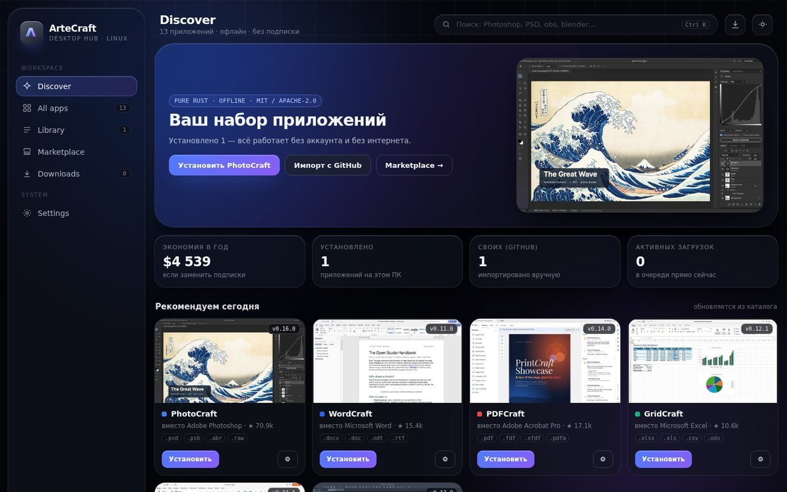
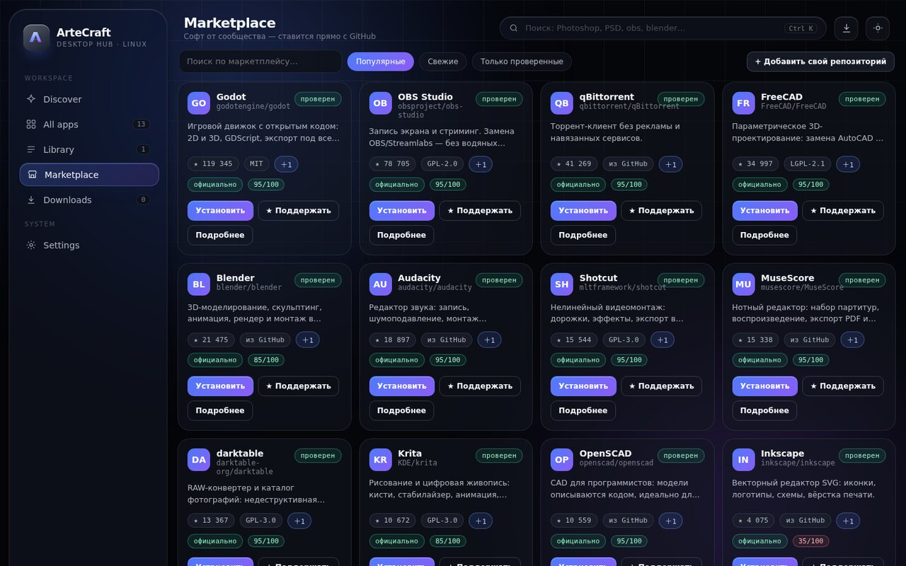
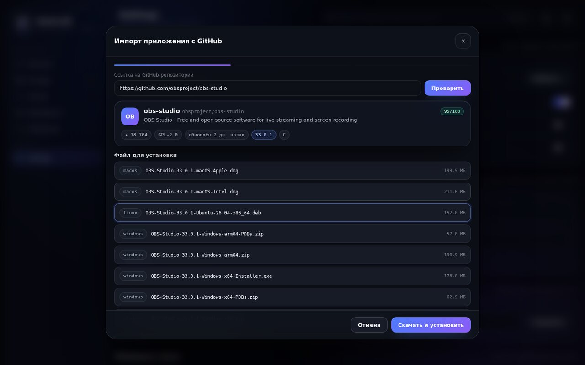
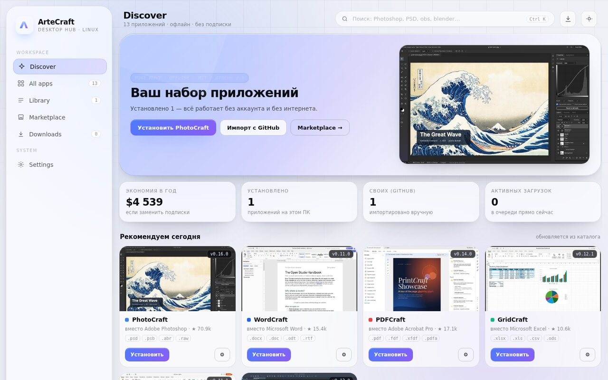
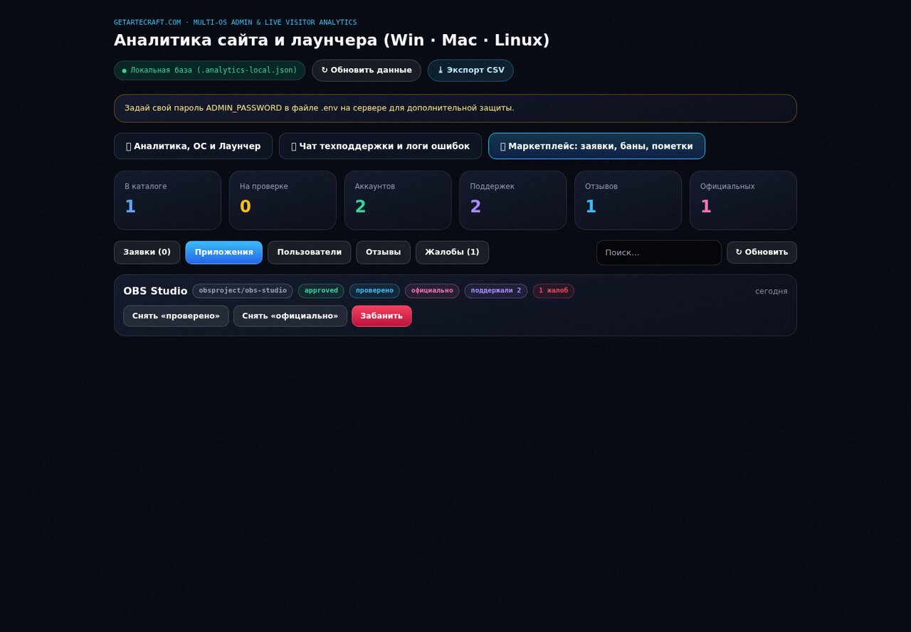

<div align="center">



# ArteCraft Desktop Hub

**Один лаунчер вместо подписок Adobe, Microsoft и Autodesk.**
13 открытых приложений в комплекте + маркетплейс, куда любой автор может добавить свой софт прямо с GitHub.

[](https://getartecraft.com/download)
[](LICENSE)
[](https://go.dev)
[](#сборка)
[](#приватность)

[Сайт](https://getartecraft.com) · [Скачать](https://getartecraft.com/download) · [Маркетплейс](https://getartecraft.com/api/market/catalog) · [Сборка](#сборка) · [Участие](CONTRIBUTING.md)

</div>

---

## Что это

ArteCraft — это десктопный хаб, который заменяет набор платных приложений открытыми аналогами:
PhotoCraft вместо Photoshop, WordCraft вместо Word, GridCraft вместо Excel, FigCraft вместо Figma и Visio,
CADCraft вместо AutoCAD, FilmCraft вместо Premiere, SoundCraft вместо Pro Tools, LightCraft вместо Lightroom,
VectorCraft вместо Illustrator, EffectCraft вместо After Effects, DesignCraft вместо InDesign,
DeckCraft вместо PowerPoint, PDFCraft вместо Acrobat.

Плюс **маркетплейс**: любой человек с аккаунтом может добавить сторонний открытый проект
одной ссылкой на GitHub — лаунчер подтянет звёзды, лицензию, релизы и файлы под вашу ОС.

<table>
<tr>
<td width="50%"></td>
<td width="50%"></td>
</tr>
<tr>
<td align="center"><b>Маркетплейс:</b> фильтры по ОС, поддержки, пометки «проверено» и «официально»</td>
<td align="center"><b>Импорт:</b> метаданные, экран риска, выбор файла под вашу систему</td>
</tr>
</table>

## Возможности

**Каталог и установка**
- 13 приложений с прогрессом загрузки, докачкой, SHA-256 и удалением
- выбор папки установки, ярлыки, автозапуск, режим Low-Spec

**Импорт с GitHub**
- принимает `owner/repo`, полный URL, `.git`, ссылки на ветку
- метаданные из GitHub API: звёзды, форки, лицензия, язык, активность, архивность
- выбор ассета под вашу ОС и архитектуру, служебные файлы (dSYM, sources, checksums) скрыты
- экран риска со score 0–100 вместо «слепой» установки
- распаковка `.zip`, `.tar.gz`, `.deb` (без установки в систему), `.AppImage`, `.exe/.msi`, `.dmg`
- скачивать можно только с `github.com` и `*.githubusercontent.com`

**Параметры запуска**
- аргументы командной строки, рабочая папка, переменные окружения
- именованные профили, пост-инсталл хук
- CLI: `artecraft list | install <repo> | launch <slug> [--args "..."]`

**Маркетплейс**
- один репозиторий = одна запись: сколько человек добавили — видно числом, без списка людей
- фильтры по ОС (Windows / macOS / Linux / моя ОС), категории, сортировка
- пометки модерации: «проверено», «официально от ArteCraft»
- **правки по пунктам**: если автор не указал ОС или описание неверное — любой может предложить правку одного поля, модератор принимает или отклоняет её отдельно
- отзывы и жалобы

**Аккаунты**
- уникальный логин `@handle`, привязка к железу (до 2 аккаунтов на устройство, до 5 устройств на аккаунт) — защита от накрутки поддержек с одного ПК

**Интерфейс**
- liquid glass: размытые панели, спекулярные кромки, живой фон
- тёмная и светлая темы, `prefers-reduced-motion`, режим Low-Spec
- один HTML-файл без фреймворков и внешних CDN — работает полностью офлайн

## Скриншоты

<div align="center">


</div>

## Установка

| Платформа | Файл |
|---|---|
| Windows 10/11 | `ArteCraft.exe` |
| macOS 11+ (Intel и Apple Silicon) | `ArteCraft-macOS-Universal.zip` |
| Linux x86_64 | `ArteCraft-Linux-x86_64.AppImage` / `.tar.gz` |

Все сборки — на [getartecraft.com/download](https://getartecraft.com/download).
Бинарники пока не подписаны, поэтому SmartScreen и Gatekeeper предупредят — это ожидаемо.

## Сборка

Нужен **Go 1.22+**. Подробности — в [docs/BUILD.md](docs/BUILD.md).

```bash
git clone https://github.com/<your-account>/artecraft-desktop
cd artecraft-desktop/src

# Linux / macOS без системных библиотек (режим локального сервера)
CGO_ENABLED=0 go build -trimpath -ldflags "-s -w" -o ArteCraft .

# Linux с окном GTK (нужны libgtk-3-dev, libwebkit2gtk-4.1-dev)
CGO_ENABLED=1 go build -o ArteCraft .

# macOS с окном WKWebView (нужны Xcode Command Line Tools)
CGO_ENABLED=1 go build -o ArteCraft .

# Windows (из Windows или кросс-компиляцией)
GOOS=windows GOARCH=amd64 CGO_ENABLED=0 go build -trimpath -ldflags "-s -w" -o ArteCraft.exe .
```

Проверка:

```bash
go vet ./...
go test ./...          # тесты нормализации ссылок, классификации ассетов, распаковки .deb
./ArteCraft --self-test
```

## Как это устроено

```
src/
  main.go                 HTTP API на 127.0.0.1:<random>, установка каталога, состояние
  market.go               импорт с GitHub, маркетплейс, параметры запуска, CLI, отпечаток устройства
  ui/index.html           весь интерфейс (liquid glass, один файл, без зависимостей)
  ui/shots/               превью приложений (вшиты через go:embed)
  platform_windows.go     окно WebView2
  platform_darwin_cgo.go  окно WKWebView
  platform_linux_cgo.go   окно GTK + WebKitGTK
  platform_linux_nocgo.go режим «только локальный сервер»
```

Лаунчер поднимает локальный HTTP-сервер, отдаёт UI и API, и открывает его в системном webview.
Всё состояние — JSON в каталоге приложения (`~/.config/ArteCraft`, `%APPDATA%\ArteCraft`,
`~/Library/Application Support/ArteCraft`). Ни телеметрии, ни аналитики из коробки.

Подробнее: [docs/ARCHITECTURE.md](docs/ARCHITECTURE.md), [docs/MARKETPLACE.md](docs/MARKETPLACE.md).

## Приватность

- нет аккаунта — нет сети: каталог и установка работают офлайн
- аккаунт нужен только для публикации, отзывов и правок в маркетплейсе
- отпечаток устройства хранится на сервере как хеш и нужен исключительно против наклона счётчиков
- из сети лаунчер обращается только к `getartecraft.com` (каталог) и `api.github.com` (по вашей ссылке)

## Участие

Issues и pull request'ы приветствуются. Перед большим PR — откройте issue.
Как добавить своё приложение в каталог — [docs/MARKETPLACE.md](docs/MARKETPLACE.md).
Правила — [CONTRIBUTING.md](CONTRIBUTING.md).

## Лицензия

MIT © ArteCraft Contributors. См. [LICENSE](LICENSE).
Названия продуктов Adobe, Microsoft, Autodesk, Figma принадлежат их владельцам;
ArteCraft не связан с ними и не поставляет их код.
